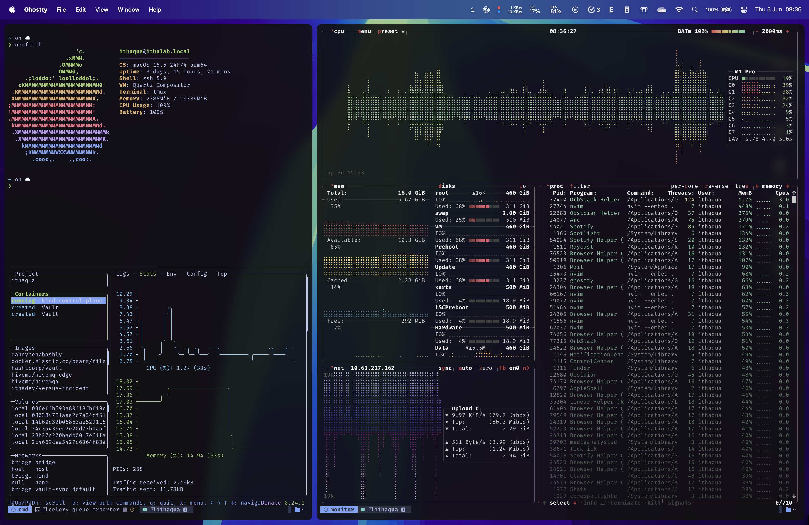

# Ithadev's environment files

This repository stores the dotfiles and configuration files for my development
environments. A small bash script, `ithactl`, symlinks them into place based on
the manifest `links.conf`.

> [!WARNING]
> Don't blindly use my settings unless you know what that entails.
> Use at your own risk!

## Preview

- 

- 

- 

## What i setup for my dev environment?

This repository includes configuration files for the following tools:

- [nvim](https://github.com/neovim/neovim)
- [tmux](https://github.com/tmux/tmux)
- [mise](https://github.com/jdx/mise)
- [neofetch](https://github.com/dylanaraps/neofetch)
- [yabai](https://github.com/koekeishiya/yabai) - Deprecated
- [skhd](https://github.com/koekeishiya/skhd) - Deprecated
- [starship](https://github.com/starship/starship)
- [wezterm](https://github.com/wez/wezterm)
- [ghostty](https://github.com/ghostty-org/ghostty)
- [hunk](https://github.com/modem-dev/hunk)
- [rex](https://www.superlogical.com/rex)
- [bat](https://github.com/sharkdp/bat) + git ([delta](https://github.com/dandavison/delta) / hunk pager)
- [ccstatusline](https://github.com/sirmalloc/ccstatusline)
- [gh-dash](https://github.com/dlvhdr/gh-dash)
- [television](https://github.com/alexpasmantier/television)
- [zsh](https://github.com/zsh-users/zsh) + [ohmyzsh](https://github.com/ohmyzsh/ohmyzsh)
- [btop](https://github.com/aristocratos/btop)
- [fabric](https://github.com/danielmiessler/fabric/tree/main)
- [k9s](https://github.com/derailed/k9s)
- [aerospace](https://github.com/nikitabobko/AeroSpace)
- [to-obsidian-note](https://github.com/ithaquaKr/to-obsidian-note)

## Setup

### Requirements

- All dependencies those tools needed.

### Using CLI

`ithactl` reads `links.conf` (one `name | source | destination | os` line per
tool) and manages the symlinks. It needs nothing but bash (3.2+ is fine).

```sh
./ithactl list              # status of every config (ok / missing / wrong / file / nosrc / n/a)
./ithactl list -q           # only the ones that need attention
./ithactl apply             # link everything for this OS, never touching existing files
./ithactl apply nvim zsh -b # link some, moving existing files aside (NAME.backup-<time>)
./ithactl apply -w          # ...or overwrite existing files
./ithactl apply -n          # dry run
./ithactl remove nvim       # remove symlinks that point into this repo
./ithactl adopt rex         # move an existing config into the repo and link it back
```

To track a new tool: add a line to `links.conf`, then `./ithactl adopt <name>`
(or put the files under `configs/` yourself and `./ithactl apply <name>`).
Secrets stay out of the repo: keep them in `~/.config/zsh/secrets.zsh`, which
`zshrc` sources if present.

## Contributing

Feel free to fork this repository and submit pull requests if you have
improvements or new configurations that could enhance this setup.

### Reporting issues

If you encounter any issues, please open an issue on the [GitHub Issue Tracker](https://github.com/ithaquaKr/dev-environment-files/issues).

## License

This repository is licensed under the MIT License.

---

Made with ❤️ by ithaquaKr
